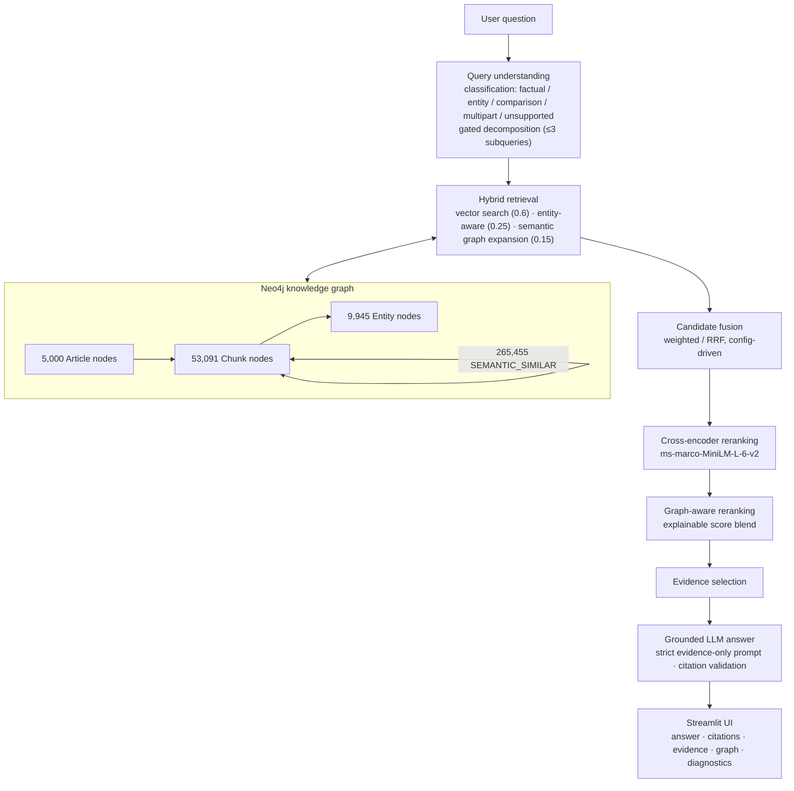

# Scientific Literature GraphRAG


**Evidence-grounded question answering over biomedical scientific literature, combining vector search with a Neo4j knowledge graph.**

Around 5,000 PubMed abstracts are chunked, embedded, entity-extracted, and stored in a Neo4j knowledge graph. A hybrid vector + graph retrieval pipeline with cross-encoder and graph-aware reranking feeds a grounded LLM that answers with validated citations. Every architectural choice is measured through ablation experiments on a deterministically constructed PubMedQA evaluation set.

## Why GraphRAG?

Pure vector search retrieves passages that *look* similar to the question but misses structured relationships: which drug treats which disease, which gene is implicated in which condition. This project stores biomedical entities (diseases, chemicals via scispaCy BC5CDR NER) and semantic chunk-similarity edges in Neo4j, then expands retrieval along the graph — so a question about "drugs for breast cancer" also surfaces treatments linked through shared entities and semantically related evidence, not just lexical matches.

## Architecture



Full design: `docs/ARCHITECTURE_PROPOSAL.md`. Reference comparison: `docs/REFERENCE_GAP_ANALYSIS.md`.

## Key features

- **Semantic chunking comparison** — four strategies evaluated (fixed-token, sentence-boundary, sentence-based, semantic clustering); fixed-token (256 tok / 32 overlap, sentence-safe) selected on measurements
- **Neo4j knowledge graph** — articles, chunks, biomedical entities, and top-5 semantic-similarity edges, with APOC + GDS
- **Hybrid retrieval** — weighted fusion of vector, entity-aware, and graph-expansion signals (RRF option)
- **Query understanding** — classification into factual / entity-focused / comparison / multipart / unsupported, with gated decomposition for multi-hop questions
- **Two-stage reranking** — cross-encoder followed by explainable graph-aware score blending
- **Grounded generation** — strict evidence-only prompting with citation validation, retry-then-strip, and an honest insufficient-evidence path
- **Polished Streamlit UI** — answer with `[n]` citations, evidence viewer, PyVis knowledge-graph visualization, retrieval diagnostics, live corpus stats, 9 selectable interface themes
- **Measured evaluation** — deterministic PubMedQA eval set; ablation systems A–G; paired tests with 95% CIs; negative results reported

## Tech stack

`sentence-transformers` (all-MiniLM-L6-v2) · scispaCy (BC5CDR biomedical NER) · Neo4j 5 + APOC + GDS · cross-encoder (`ms-marco-MiniLM-L-6-v2`) · provider-agnostic LLM (Groq / OpenAI / Ollama) · Streamlit + PyVis · ROUGE + BERTScore + faithfulness suite

## Dataset

~5,000 PubMed abstracts (full corpus), plus an audited 200-abstract pilot. The evaluation set is 200 PubMedQA questions with PMID-equality gold matching, deterministically constructed — see `docs/EXPERIMENT_PLAN.md` §2 and the manifests in `data/evaluation/`. Raw downloads and intermediate artifacts are git-ignored and reproducible via `scripts/`; only small evaluation manifests are committed.

## Pipeline

1. **Corpus build** (`scripts/build_full_corpus.py`) — fetch and audit PubMed abstracts
2. **Chunking** (`scripts/chunk_corpus.py`) — four strategies compared via `scripts/evaluate_chunking.py`
3. **Embeddings** — all-MiniLM-L6-v2 (384-dim); a PubMedBERT candidate was rejected after measurement (severe anisotropy, 6.2× slower, no measured gain)
4. **Entity extraction** — scispaCy `en_ner_bc5cdr_md` (diseases, chemicals)
5. **Graph build** (`scripts/build_graph.py`) — Article / Chunk / Entity nodes, `SEMANTIC_SIMILAR` top-5 edges, 384-dim vector index
6. **Retrieval** — hybrid weighted fusion → cross-encoder rerank → graph-aware rerank
7. **Generation** — evidence-grounded LLM with validated citations
8. **Serve** — `streamlit run app.py` or `scripts/ask.py` CLI

## Measured results

Question→source-abstract retrieval on 200 PubMedQA questions (PMID-deduplicated ranking). **This is a retrieval benchmark, not open-domain QA accuracy.**

| Metric | Hybrid | Hybrid + CrossEncoder | Δ |
|---|---|---|---|
| Recall@5 | 0.9450 | **0.9850** | +0.0400 |
| MRR | 0.8623 | **0.9689** | +0.1066 |
| nDCG@10 | 0.8885 | 0.9729 | +0.0844 |

Full per-query results: `data/evaluation/retrieval_eval_5a.json`. Details: `docs/DEMO_GUIDE.md` §8, `docs/EXPERIMENT_PLAN.md`.

## Installation

```bash
cp .env.example .env          # fill in SGRAG_* values (fresh keys for this project)
./scripts/setup_env.sh        # creates .venv, installs the package (Python 3.12 required)
```

Python 3.12 is required: the pinned spaCy 3.7.5 / scispaCy 0.6.2 chain has no Python 3.13 wheels. See `pyproject.toml` for the full rationale.

## Environment configuration

All variables use the `SGRAG_` prefix (see `.env.example`):

| Variable | Purpose |
|---|---|
| `SGRAG_NEO4J_URI` / `SGRAG_NEO4J_USER` / `SGRAG_NEO4J_PASSWORD` | Neo4j connection |
| `SGRAG_LLM_PROVIDER` (`groq` \| `openai` \| `ollama`) | LLM backend |
| `SGRAG_LLM_MODEL` / `SGRAG_LLM_API_KEY` | Model and key |
| `SGRAG_TOP_K` / `SGRAG_RERANK_POOL_SIZE` | Retrieval defaults (overridable per experiment YAML) |

A deterministic mock LLM provider is available for offline runs.

## Neo4j setup

```bash
docker compose up -d          # Neo4j 5.26 + APOC + GDS
```

Then build the graph: `./scripts/build_graph.py` (see `docs/DEMO_GUIDE.md` for the full data-load sequence). The sidebar shows live corpus counts when Neo4j is reachable, and an honest "unreachable" fallback otherwise.

## Running the app

```bash
streamlit run app.py          # Streamlit UI: answer · citations · evidence · graph · diagnostics
python scripts/ask.py "What drugs are associated with breast cancer treatment?"   # CLI
```

Try: *"What are the risk factors associated with Alzheimer's disease?"*

## Running tests

```bash
.venv/bin/python -m pytest -q
```

162 tests: unit, integration, and end-to-end (some integration tests skip gracefully when Neo4j is unreachable).

## Project structure

```text
app.py              Streamlit application (answer, citations, evidence, graph, diagnostics, themes)
src/sgrag/          Python package: config, data, chunking, embeddings, entities, graph,
                    retrieval, reranking, query, generation, evaluation, utils
configs/            Experiment configs (baseline → full); one command reproduces a run
scripts/            Pipeline scripts: corpus build, chunking, graph build, retrieval,
                    reranking eval, ask CLI, setup
data/               raw/ interim/ processed/ (git-ignored, regenerable)
data/evaluation/    Committed eval manifests (small; reproducibility depends on them)
tests/              unit/ integration/ e2e/
docs/               architecture proposal, experiment plan, graph schema, demo guide,
                    implementation roadmap, knowledge bytes, reference gap analysis
docker-compose.yml  Neo4j 5 + APOC + GDS
.streamlit/         Streamlit theme + client configuration
```

## Limitations

- PubMedQA gold granularity is the abstract; chunk-level labels are weak by construction.
- Some PubMedQA gold abstracts may be un-fetchable; drops are audited, never hidden.
- Biomedical NER and cross-encoders are CPU-feasible but add latency — measured per stage.
- The mock LLM provider produces illustrative answers only; grounded answers require a real LLM key.
- Graph statistics in the UI require a running Neo4j instance.

## Future scope

- Abstract-level → full-text ingestion and finer-grained evidence spans
- Learned fusion weights instead of fixed hybrid weights
- Community detection (Louvain/GDS) for community-level summarization
- Latency optimization for the reranking stages
- Expanded faithfulness metrics over larger eval sets

## License

MIT — see `LICENSE`.
